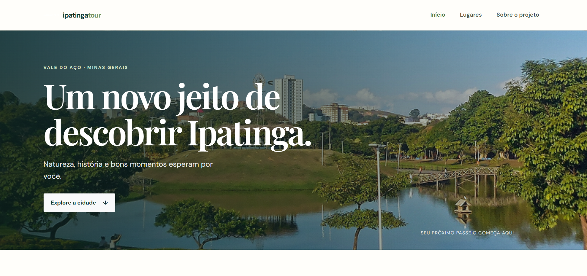
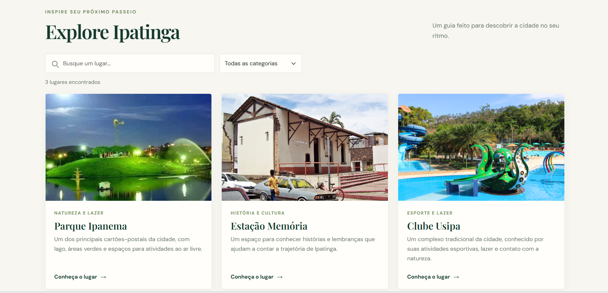

# Ipatinga Tour

Guia turístico responsivo de Ipatinga, desenvolvido como projeto acadêmico. A página inicial exibe lugares em destaque, uma lista dinâmica de destinos com busca e filtro por categoria, e uma seção de apresentação do projeto. Cada lugar tem uma página própria, acessada pelo identificador na URL, com informações e fotos relacionadas.

## Prévia no desktop

<table>
  <tr>
    <td align="center"></td>
    <td align="center"></td>
  </tr>
  <tr>
    <td align="center"></td>
    <td align="center"></td>
  </tr>
</table>

## Como executar

Abra `index.html` no navegador ou execute o projeto com a extensão Live Server do Visual Studio Code. A página usa Bootstrap 5 e as fontes do Google Fonts por CDN.

## Organização

- `index.html`: página inicial e estrutura das seções.
- `detalhes.html`: página de detalhes carregada com o parâmetro `id`.
- `assets/js/app.js`: dados em JSON e renderização dinâmica das páginas.
- `css/style.css`: identidade visual e estilos responsivos.
- `images/`: imagens dos destinos e capturas de tela do projeto.

## Responsável

Bernardo Almeida Andrade
